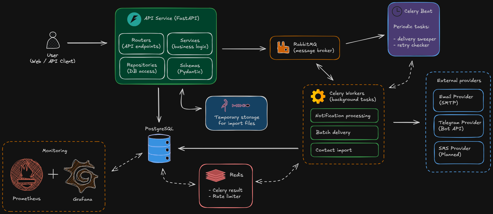

# Emergency Notification System (ENS)

**Emergency Notification System (ENS)** — backend-система для массовой отправки экстренных текстовых уведомлений заранее определённым группам получателей через несколько каналов связи.

Система позволяет управлять контактами, способами связи, группами получателей и шаблонами сообщений, а затем инициировать массовую рассылку одним API-запросом.

Отправка выполняется асинхронно с использованием очередей сообщений и фоновых обработчиков. Для каждой доставки сохраняется отдельный статус, а при ошибках предусмотрены повторные попытки и механизмы восстановления обработки.

## Основные возможности

- **Управление контактами** — хранение получателей и их контактных данных.
- **Управление группами** — объединение получателей в группы для целевых рассылок.
- **Управление шаблонами** — создание и использование шаблонов текстовых сообщений.
- **Импорт контактов** — асинхронная загрузка контактных данных из CSV/XLSX-файлов с обработкой данных частями.
- **Массовая рассылка** — отправка уведомлений всем активным контактам выбранной группы.
- **Несколько каналов доставки** — поддержка Email и Telegram.
- **Отслеживание доставки** — отдельный статус для каждой доставки и итоговый статус уведомления.
- **История уведомлений** — сохранение уведомлений и связанных с ними доставок.
- **Автоматические повторные попытки** — повторная обработка неуспешных доставок.
- **Восстановление обработки** — обнаружение и восстановление задач, прерванных из-за сбоя приложения или Worker.
- **Ограничение частоты отправки** — соблюдение лимитов внешних провайдеров.
- **Мониторинг** — сбор и визуализация метрик с помощью Prometheus и Grafana.

## Архитектура

Система построена на основе асинхронной архитектуры с разделением API и фоновой обработки.

API отвечает за приём запросов, валидацию данных и взаимодействие с основной базой данных. Отправка уведомлений и обработка импортируемых файлов выполняются фоновыми задачами Celery через RabbitMQ.



### Основные компоненты

| Компонент | Назначение |
|---|---|
| FastAPI | REST API и обработка входящих запросов |
| PostgreSQL | Хранение контактов, групп, шаблонов, уведомлений, доставок и заданий импорта |
| RabbitMQ | Брокер сообщений для асинхронной обработки задач |
| Celery Worker | Обработка уведомлений, партий доставок и импортируемых контактов |
| Celery Beat | Периодический запуск системных задач восстановления |
| Redis | Хранение результатов Celery и распределённое ограничение частоты запросов к провайдерам |
| MinIO | Временное хранение файлов импорта |
| Prometheus | Сбор метрик приложения |
| Grafana | Визуализация метрик и мониторинг состояния системы |

### Структура проекта

```text
app/
├── api/              # REST API endpoints
├── core/             # Конфигурация, логирование, rate limiting, S3
├── db/               # Подключение к БД и Unit of Work
├── exceptions/       # Исключения приложения
├── metrics/          # Метрики Prometheus
├── models/           # Модели SQLAlchemy
├── providers/        # Интеграции с провайдерами доставки
├── repositories/     # Слой доступа к данным
├── schemas/          # Pydantic-схемы
├── services/         # Бизнес-логика
├── tasks/            # Фоновые задачи Celery
└── validators/       # Валидация контактных данных

migrations/           # Миграции Alembic
docker/               # Docker-конфигурации
monitoring/           # Конфигурация Prometheus и Grafana
tests/                # Автоматизированные тесты

Dockerfile
docker-compose.yml
alembic.ini
pyproject.toml
poetry.lock
```

## Принцип работы рассылки

1. Клиент отправляет запрос на создание уведомления, указывая группу получателей, шаблон и необходимые переменные.
2. API проверяет входные данные и создаёт запись уведомления.
3. Для каждого активного Contact Method каждого активного получателя создаётся отдельная запись Delivery.
4. После запуска уведомления задачи на обработку доставок передаются в RabbitMQ.
5. Celery Worker получает задачи и обрабатывает доставки партиями.
6. Каждая доставка отправляется через соответствующего провайдера — Email или Telegram.
7. Результат отправки, статус доставки и идентификатор сообщения провайдера сохраняются в PostgreSQL.
8. После завершения обработки всех доставок обновляется итоговый статус уведомления.

### Модель доставки

Каждый активный способ связи получателя рассматривается как отдельная доставка.

Например, если у пользователя есть два Email-адреса и один Telegram-контакт, для него будет создано три отдельные доставки.

Если группа содержит 100 пользователей, каждый из которых имеет по два активных способа связи, система создаст 200 записей Delivery.

Деактивированные контакты и неактивные способы связи не участвуют в рассылке. Попытка отправить уведомление в деактивированную группу отклоняется.

**Ограничения рассылки:**

| Параметр | Значение |
|---|---:|
| Максимальное количество доставок на уведомление | 50 000* |
| Размер одной партии доставок | 200 |
| Максимальный размер сообщения | 4 KB |
| Формат сообщений | Текстовые шаблоны с поддержкой переменных |
| Вложения | Не поддерживаются |

\* Предварительное проектное ограничение. Требует подтверждения нагрузочным тестированием.

Каждая партия доставок обрабатывается отдельной задачей Celery и может быть назначена любому доступному Worker.

## Жизненный цикл уведомлений и доставок

### Статусы Notification

Уведомление проходит следующие этапы:

```text
PENDING
   |
   v
IN_PROGRESS
   |
   +------> SUCCESS
   |
   +------> PARTIAL_SUCCESS
   |
   +------> FAILED
```
Промежуточные статусы:

- `PENDING` — уведомление создано, но ещё не обрабатывается.
- `IN_PROGRESS` — выполняется обработка доставок.

Итоговые статусы:

- `SUCCESS` — все доставки завершили обработку успешно.
- `PARTIAL_SUCCESS` — все доставки завершили обработку, но часть из них завершилась ошибкой.
- `FAILED` — все доставки завершили обработку ошибкой.

### Статусы Delivery

Каждая доставка отслеживается независимо:

```text
                 PENDING
                    |
                    v
                 Отправка
                    |
           +--------+--------+
           |                 |
           v                 v
         SENT              Ошибка
                             |
                    +--------+--------+
                    |                 |
                    v                 v
             Попытки остались   Попытки исчерпаны
                    |                 |
                    v                 v
             Ожидание повтора       FAILED
                    |
                    v
                 PENDING
```

При ошибке доставки выполняются повторные попытки. Поле `next_attempt_at` определяет время, после которого доставка снова становится доступной для обработки.

После исчерпания всех попыток доставка получает статус `FAILED`.

`SENT` — сообщение успешно передано соответствующему провайдеру, который подтвердил принятие запроса на отправку.


## Надёжность и восстановление

Одно из ключевых требований ENS — минимизация риска потери уведомлений.

Для этого используются следующие механизмы.

### Надёжная обработка задач

Очередь RabbitMQ объявляется как durable (durable=True), что позволяет сохранять её определение после перезапуска брокера.

Celery использует следующие настройки:

- `task_acks_late=True` — подтверждение выполнения задачи происходит после её обработки.
- `task_reject_on_worker_lost=True` — задача возвращается в очередь при потере Worker.
- `worker_prefetch_multiplier=1` — Worker получает ограниченное количество задач заранее.

Эти настройки позволяют повторно обработать задачи после сбоев фоновых процессов.

### Повторные попытки доставки

При ошибке взаимодействия с провайдером система выполняет повторные попытки.

| Параметр | Значение |
|---|---:|
| Максимальное количество попыток (включая первоначальную) | 5 |
| Интервал между попытками | 60 секунд |
| Период запуска `sweeper` | 60 секунд |

### Восстановление через Sweeper

Периодическая задача `sweeper`, запускаемая через Celery Beat, выполняет две основные операции:

- Повторно отправляет доставки, для которых наступило время следующей попытки.
- Завершает обработку уведомлений, оставшихся в статусе `IN_PROGRESS` после аварийного завершения работы приложения или Worker.

Если провайдер фактически доставил сообщение, но ответ об успешной отправке не был получен системой, повторная попытка может привести к дублированию сообщения. Для экстренных уведомлений такой компромисс допустим: приоритет отдаётся доставке, а не строгой гарантии отсутствия дубликатов.

Повторный вызов `POST /notifications/{id}` для уже завершённого уведомления не создаёт новые доставки. Для повторной рассылки необходимо создать новое уведомление.

После исчерпания количества попыток повторной доставки она прекращается. Доставка сохраняет финальный статус ошибки и остаётся доступной в истории для последующего анализа. Механизм автоматизированной обработки таких доставок (DLQ) в текущую версию не входит.

## Производительность и масштабирование

Архитектура предусматривает независимое масштабирование API и фоновых обработчиков.

- **API** — количество экземпляров можно увеличивать независимо от количества Worker.
- **Worker** — количество фоновых обработчиков можно увеличивать в зависимости от объёма очереди и нагрузки на провайдеров.


Время начала отправки зависит от загрузки очереди и доступности Worker.

Приоритет отдаётся надёжной обработке и восстановлению доставок.

## Ограничение скорости отправки

Внешние провайдеры имеют собственные ограничения на количество запросов в единицу времени.

Для соблюдения этих ограничений используется распределённый rate limiter на базе Redis.

Лимиты задаются отдельно для каждого поддерживаемого канала доставки.

## Мониторинг и логирование

### Метрики

Prometheus используется для сбора метрик приложения, Grafana — для их визуализации.

Система предусматривает мониторинг следующих показателей:

- количество уведомлений в обработке;
- количество уведомлений с различными статусами;
- количество успешных доставок;
- количество запросов, отклонённых из-за Rate Limit;
- среднее время доставки;
- количество повторных попыток.

### Логирование

Логируются основные события жизненного цикла уведомлений и доставок:

- создание уведомления;
- начало обработки;
- завершение обработки;
- ошибки доставки;
- ошибки взаимодействия с провайдерами;
- выполнение повторных попыток.

## Технологический стек

| Категория | Технологии |
|---|---|
| Язык программирования | Python 3.12 |
| API | FastAPI, Uvicorn |
| Валидация данных | Pydantic |
| ORM | SQLAlchemy 2 |
| База данных | PostgreSQL 16 |
| Миграции | Alembic |
| Фоновые задачи | Celery |
| Брокер сообщений | RabbitMQ |
| Кэш и распределённый rate limiting | Redis |
| Объектное хранилище | MinIO |
| Email | SMTP, aiosmtplib |
| Telegram | Telegram Bot API, HTTPX |
| Мониторинг | Prometheus, Grafana |
| Контейнеризация | Docker, Docker Compose |
| Тестирование | Pytest, pytest-asyncio |
| Качество кода | Ruff, Black, mypy |

## Запуск проекта

### Требования

Для запуска проекта необходимы:

- Python 3.12 (для локального запуска);
- Docker;
- Docker Compose;
- Poetry (для локальной разработки).

### 1. Клонирование репозитория

```bash
git clone https://github.com/AlexAiroko/emergency_notification_system.git
cd emergency_notification_system
```

### 2. Настройка переменных окружения

Создайте файл `.env` на основе примера:

```bash
cp .env.example .env
```

Укажите необходимые параметры подключения к базе данных и внешним сервисам.

Для запуска через Docker Compose задайте:

```env
DB_HOST=db
```

Также заполните параметры SMTP и Telegram Bot API:

```env
SMTP_HOST=smtp.gmail.com
SMTP_PORT=587
SMTP_USERNAME=your_email@gmail.com
SMTP_PASSWORD=your_app_password
SMTP_FROM=your_email@gmail.com
SMTP_USE_TLS=true

TELEGRAM_BOT_TOKEN=your_telegram_bot_token
```

Остальные параметры можно оставить со значениями из `.env.example` для локального ознакомления с проектом.

### 3. Запуск через Docker Compose

```bash
docker compose up --build -d
```

Docker Compose поднимет необходимые сервисы:

- FastAPI;
- PostgreSQL;
- RabbitMQ;
- Redis;
- MinIO;
- Celery Worker;
- Celery Beat;
- Prometheus;
- Grafana.

Миграции базы данных выполняются отдельным сервисом при запуске окружения.

### 4. Документация API

После запуска приложения Swagger UI доступен по адресу:

```text
http://localhost:8000/docs
```

ReDoc:

```text
http://localhost:8000/redoc
```

Проверка состояния API:

```text
http://localhost:8000/health
```

### 5. Мониторинг

После запуска сервисов доступны:

| Сервис | Адрес |
|---|---|
| Prometheus | http://localhost:9090 |
| Grafana | http://localhost:3000 |
| RabbitMQ Management | http://localhost:15672 |
| MinIO Console | http://localhost:9001 |

Для локального окружения Grafana настроена со стандартными учётными данными:

```text
Login: admin
Password: admin
```

Не используйте эти учётные данные в публичном или производственном окружении.

## Тестирование

Для запуска тестов локально установите зависимости:

```bash
poetry install
```

Запустите тесты:

```bash
poetry run pytest
```

Для запуска с отчётом о покрытии:

```bash
poetry run pytest --cov=app
```

Тесты проекта организованы по основным слоям приложения: API, сервисы, репозитории, провайдеры, фоновые задачи, метрики и валидаторы.

## Ограничения текущей версии

В первой версии реализованы Email и Telegram. Следующие возможности пока не поддерживаются:

- другие провайдеры (SMS, Push и т.д.);
- планирование отправки на будущее;
- пользовательские периодические уведомления;
- приоритеты уведомлений;
- пауза и отмена активной рассылки;
- несколько провайдеров одного канала.

Система также не отвечает за аутентификацию, регистрацию пользователей, роли и управление доступом. Эти функции должны обеспечиваться внешней системой.

## Дальнейшее развитие

Архитектура предусматривает возможность расширения системы без существенной переработки существующей бизнес-логики.

В качестве направлений дальнейшего развития рассматриваются:

- добавление новых каналов доставки;
- выделение отдельных очередей и Worker для каждого канала;
- горизонтальное масштабирование API с использованием Load Balancer;
- Dead Letter Queue (DLQ) для обработки задач, исчерпавших автоматические попытки;
- инструменты ручной обработки неуспешных доставок;
- расширение возможностей мониторинга и логирования.

